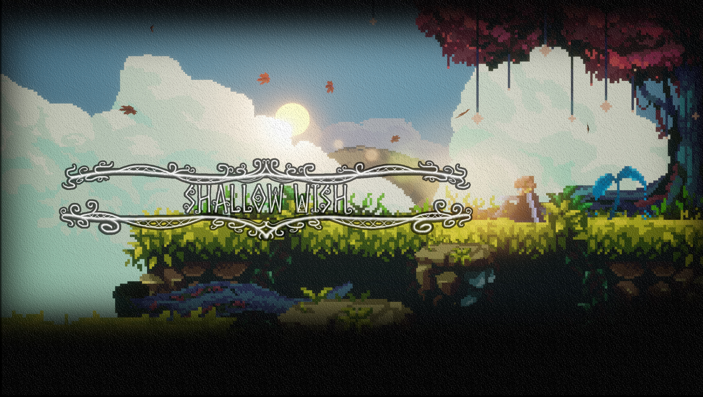

<p align="center">
  
</p>

<h1 align="center">Shallow Wish Press Kit</h1>

<p align="center">
  Official press kit for Shallow Wish by Indiependent Games Studio.
</p>

<p align="center">
  <a href="https://indiependentgamesstudio.com"><b>🌐 Website</b></a>
  &nbsp;&nbsp;|&nbsp;&nbsp;
  <a href="mailto:official@indiependentgamesstudio.com"><b>📧 Press Contact</b></a>
</p>

---

## Structure

```
01_Key_Art/
├── Covers/                 Mountain, Dragon, Planets, Tree and Lake artwork in 4K, 1080p and smaller sizes
├── Banner/
├── Header/                 Wide headers with logo
└── Square/
02_Screenshots/
├── Featured/               Best picks, in full resolution
│   └── 1080p/              Same picks in 1080p
└── Gameplay/
03_Videos/
├── Trailers/
├── Gameplay_Clips/
└── Shorts/
04_Behind_the_Scenes/       Original hand-drawn world map
```

## Usage

All assets are free to use for coverage of Shallow Wish: articles, reviews, videos, streams and social media, including monetized content. Please don't alter the logo or characters.

## Contact

[official@indiependentgamesstudio.com](mailto:official@indiependentgamesstudio.com)

Socials are linked in the footer of [indiependentgamesstudio.com](https://indiependentgamesstudio.com) and on [Linktree](https://linktr.ee/indiependent.games.studio).

<p align="center">
  <sub>© Indiependent Games Studio</sub>
</p>
